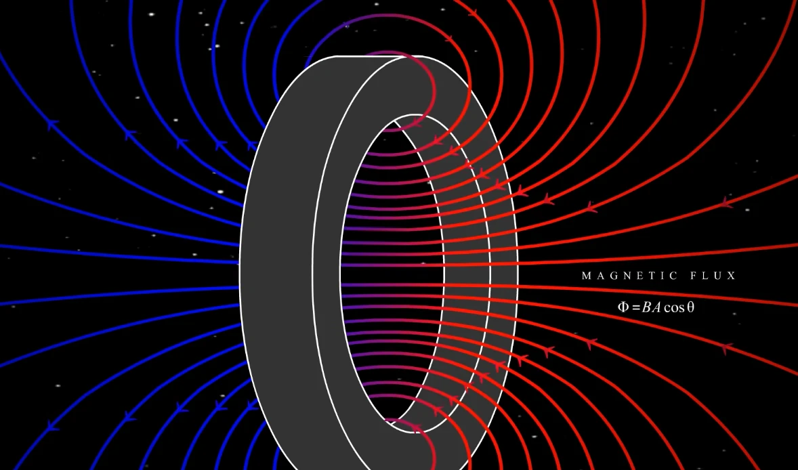
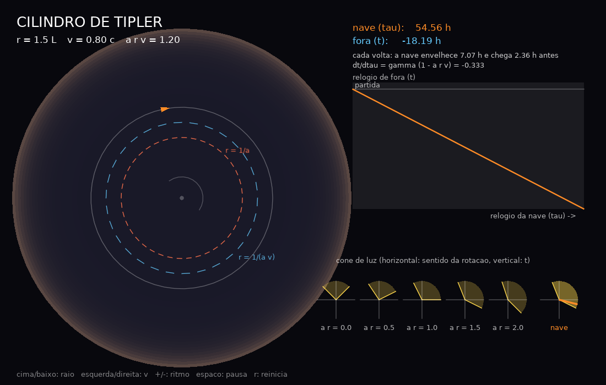

# lua-physics

cada pasta tem um arquivo `.lua` que roda direto no terminal.

## como rodar

1. instala o lua (https://www.lua.org/download.html, ou no windows `winget install DEVCOM.Lua`)
2. abre o terminal na pasta `lua-physics`
3. roda o projeto que quiser, ex: `lua 2fa/2fa.lua`

## projetos

### acelerador

Imagine que voce magnetiza uma barra de ferro, monta um solenoide em um foguete (que vira um ima), passa por varios aneis magneticos e
ganha velocidade. o codigo mostra quanto de beta (velocidade / velocidade da
luz) da pra ganhar, com a correcao de lorentz, compara com a conta de newton, e no final com o estilingue
gravitacional.

um material como o ferro eh cheio de dominios magneticos, pedacinhos que
funcionam como mini imas. baguncados, um cancela o outro. alinhados, o
material vira um ima. corrente passando num fio enrolado (solenoide) cria
campo magnetico, e um nucleo de ferro dentro multiplica esse campo. quando um
ima passa por um anel, o fluxo magnetico pelo anel muda, e campo que muda gera
corrente (lei de faraday): eh essa interacao que empurra o foguete.

```
lua acelerador/acelerador.lua
```

o estilingue tambem tem animacao numa janela (precisa do [LOVE](https://love2d.org),
`winget install Love2d.Love2d`): a gravidade curva o caminho da nave em volta do
planeta, calculada passo a passo, e o painel mostra vi, U e a velocidade final.

```
& "C:\Program Files\LOVE\love.exe" acelerador
```

na janela: cima/baixo passa mais perto ou mais longe do planeta, esquerda/direita
muda vi, +/- muda o ritmo, espaco pausa, r reinicia.

formulas:
- barra magnetizada: B = 2 T * alinhamento dos dominios (media de cos do angulo)
- campo no solenoide: B = n * mu * I
- fluxo no anel: fluxo = B * A * cos(theta)
- energia por anel: eta * B^2 / (2 * mu0) * volume
- fator de lorentz: gamma = 1 + k * E_anel / (m * c^2)
- velocidade: beta = sqrt(1 - 1/gamma^2)
- estilingue gravitacional: vf = (vi + 2U) * sqrt(1 - 4 vi U (1 - cos theta) / (vi + 2U)^2)



*as linhas de campo atravessando o buraco do anel sao o fluxo magnetico
(fluxo = B A cos theta). de frente pro campo o fluxo eh maximo, de lado eh zero.*


*estilingue gravitacional: visto pelo planeta, a nave so muda de direcao. como o
planeta ta andando, visto de fora isso vira ganho de velocidade: ela chega quase
parada (150 m/s) num planeta a 10 km/s e sai com o dobro.*

o que sai:
1. **barra**: com 1000 dominios sorteados, cada passada de um ima alinha mais.
   o alinhamento vai de ~0 pra 0.63, 0.90, 0.97... e a barra chega perto de 2 T
2. **solenoide com 2 espiras**: so no ar da 0.0025 T. com a barra de ferro
   dentro passaria de 2.5 T, mas o ferro satura em 2 T
3. **fluxo no anel** (raio 0.1 m, 1.26 T): 0.0395 Wb de frente, cai com cos
   theta e vira zero com o anel de lado
4. **foguete a 4197261 m/s**: parece muito, mas eh beta 1.4%. o relogio do
   foguete quase nao atrasa (29.997 s a cada 30 s). com um solenoide real
   seriam ~3 x 10^12 aneis
5. **aneis exagerados** (5% de mc^2 por anel): chega em beta 0.8 no anel 14.
   o relogio do foguete anda a 60% do nosso (passam 30 s aqui, 18 s la)
6. **solenoide real** (1.26 T, ~3 kJ por anel): precisaria de ~2 x 10^16 aneis
   pra beta 0.8
7. **estilingue** (U = 10000 m/s, vi = 150 m/s): com theta = 45 graus sai a
   20106 m/s. o maximo, dando a volta completa, eh vi + 2U = 20150 m/s
8. **jupiter de verdade**: 20 sobrevoos nao chegam nem perto de 0.8

### 2fa

o codigo de 6 numeros do app autenticador (2FA) muda a cada 30 segundos, e
o servidor so aceita se o relogio do seu celular bater com o dele. pela
relatividade, o relogio de quem viaja perto da velocidade da luz anda mais
devagar: a 0.8c, enquanto passam 30 s na terra, passam so 18 s pro viajante.
o codigo dele vai ficando pra tras ate o servidor recusar.

```
lua 2fa/2fa.lua
```

tem tambem uma animacao numa janela, feita com [LOVE](https://love2d.org)
(`winget install Love2d.Love2d`): o foguete indo embora, os dois relogios, os
codigos do servidor e do celular e o login ficando verde, amarelo e vermelho.

```
& "C:\Program Files\LOVE\love.exe" 2fa
```

na janela: cima/baixo muda a velocidade, esquerda/direita acelera o tempo,
espaco pausa, r reinicia.

formulas:
- fator de lorentz: gamma = 1 / sqrt(1 - beta^2)
- relogio do viajante: t_viajante = t_terra / gamma
- janela do codigo: floor(t / 30)
- relogio do GPS: -beta^2 / 2 (velocidade) + GM/c^2 * (1/R_terra - 1/r_satelite) (gravidade)

o codigo de 6 numeros eh gerado de verdade (TOTP com HMAC-SHA1), e confere com
o exemplo oficial da RFC 6238.

o que sai:
1. **viajante a 0.8c**: o servidor aceita o codigo dele com 1 janela de folga,
   mas aos 90 s na terra (54 s pra ele) ja recusa
2. **tempo ate trancar**: a 0.01c leva 6.9 dias, a 0.1c 100 min, a 0.99c 60 s.
   o kerberos (login de rede, que aceita 5 min de diferenca) aguenta de 6 a 10 vezes mais
3. **GPS de verdade**: a velocidade atrasa o relogio do satelite 7.2 microssegundos por dia,
   a gravidade mais fraca adianta 45.7. sobra +38.5 microssegundos por dia, que sem
   correcao viraria 11.5 km de erro por dia

### tipler

o cilindro de tipler eh um cilindro infinito, muito denso, girando muito
rapido. a ideia eh que a rotacao arrasta o espaco-tempo junto (arrasto de
referencial, o mesmo efeito que a sonda gravity probe B mediu em volta da
terra, so que absurdamente mais forte). o codigo usa a solucao exata de
van stockum (1937): poeira girando, preenchendo tudo em volta de um eixo.
tipler (1974) mostrou que um cilindro assim pode virar maquina do tempo.

```
lua tipler/tipler.lua
```

o cone de luz eh o conjunto de caminhos que da pra seguir sem passar da luz:
pra cima eh o futuro. perto do eixo ele eh normal (45 graus pra cada lado).
quanto mais longe do eixo, mais a rotacao tomba o cone no sentido do giro. em
r = 1/a a borda da frente fica deitada, e depois disso ela aponta pra baixo:
andar no sentido do giro, mesmo devagar, pode levar pra um t menor. dando a
volta, a nave chega antes de sair.

e de dentro da nave? nada de estranho. o relogio da nave (tau) sempre anda pra
frente, ninguem fica mais novo, tudo dentro envelhece normal. o que vai pra
tras eh o t, o relogio da poeira parada em cada lugar (o "de fora"). quando a
nave volta pro eixo, o relogio de la marca uma hora antes da partida.

tem animacao numa janela ([LOVE](https://love2d.org)): a nave dando voltas, os
dois relogios, o grafico de t contra tau e os cones de luz tombando.

```
& "C:\Program Files\LOVE\love.exe" tipler
```

na janela: cima/baixo muda o raio da volta, esquerda/direita muda v, +/- muda o
ritmo, espaco pausa, r reinicia.



*a nave a 0.8c em r = 1.5 L, por fora do circulo azul (r = 1/(a v)): a cada
volta ela envelhece 7.07 h e chega 2.36 h antes. no grafico o relogio dela so
sobe, o de fora so desce. embaixo, o cone de luz tomba conforme r cresce; no da
nave, o caminho laranja aponta pra baixo da linha de t parado.*

formulas (c = G = 1, comprimento em L = 1/a):
- metrica: ds^2 = -(dt + a r^2 dphi)^2 + r^2 dphi^2 + exp(-a^2 r^2) (dr^2 + dz^2)
- g_phiphi = r^2 (1 - a^2 r^2): negativo depois de r = 1/a, ai um circulo com t
  parado eh tipo tempo (curva fechada do tipo tempo, CTC)
- arrasto: omega = a / (1 - a^2 r^2)
- borda da frente do cone: dt/dx = 1 - a r (x = r phi)
- volta a velocidade v (medida pela poeira): dt/dtau = gamma (1 - a r v).
  volta no tempo quando a r v > 1

o que sai:
1. **cone de luz**: borda da frente a 45 graus no eixo, 26.6 em r = 0.5 L,
   0 em r = 1 L e -45 em r = 2 L. a luz que da a volta em r = 2 L chega
   12.6 h antes
2. **CTC** em r = 2 L: o circulo com t parado eh tipo tempo. uma volta leva 0 h
   de fora e 21.77 h pra quem esta dentro
3. **velocidade minima**: a 0.5c precisa de r > 2 L, a 0.99c de r > 1.01 L
4. **maquina do tempo** (L = 1 hora-luz): sai do eixo a 0.5c ate r = 2 L
   (2.39 h), da 4 voltas a 0.8c (cada uma -9.42 h de fora e +9.42 h na nave) e
   volta. chega 32.91 h antes de sair, tendo envelhecido 41.84 h

na pratica: a poeira de van stockum enche o universo inteiro (a densidade cresce
com exp(a^2 r^2) indo pra fora) e um cilindro de verdade precisaria ser infinito.
hawking (1992) mostrou que, com tamanho finito, so daria pra criar uma CTC
usando energia negativa, que ninguem sabe se existe nessa quantidade.
