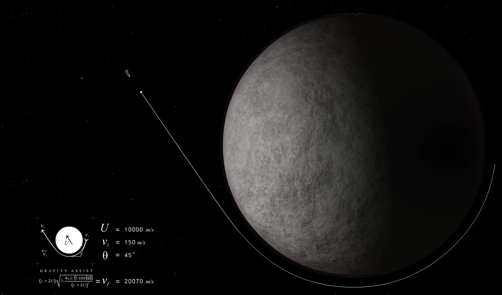

# lua-physics

mini projetos de fisica em lua, um pra cada duvida que tive vendo esse video:
https://www.youtube.com/watch?v=ErMSHiQRnc8

cada pasta tem um arquivo `.lua` com tudo comentado, feito pra dar pra entender
mesmo sem saber programar.

## como rodar

1. instala o lua (https://www.lua.org/download.html, ou no windows `winget install DEVCOM.Lua`)
2. abre o terminal na pasta `lua-physics`
3. roda o projeto que quiser, ex: `lua doppler/doppler.lua`

## projetos

### acelerador

segue a ordem do video: o bonequinho magnetiza uma barra de ferro, monta um
solenoide no foguete (que vira um ima), passa por varios aneis magneticos e
ganha velocidade. o codigo mostra quanto de beta (velocidade / velocidade da
luz) da pra ganhar, com a correcao de lorentz, compara com a conta de newton
(que passa da velocidade da luz, o que nao pode) e no final com o estilingue
gravitacional.

```
lua acelerador/acelerador.lua
```

formulas:
- barra magnetizada: B = 2 T * alinhamento dos dominios (media de cos do angulo)
- campo no solenoide: B = n * mu * I
- fluxo no anel: fluxo = B * A * cos(theta)
- energia por anel: eta * B^2 / (2 * mu0) * volume
- fator de lorentz: gamma = 1 + k * E_anel / (m * c^2)
- velocidade: beta = sqrt(1 - 1/gamma^2)
- estilingue do video: vf = (vi + 2U) * sqrt(1 - 4 vi U (1 - cos theta) / (vi + 2U)^2)


*um dos aneis: as linhas de campo atravessando o buraco sao o fluxo
magnetico (fluxo = B A cos theta). imagem do [video](https://www.youtube.com/watch?v=ErMSHiQRnc8).*



*estilingue gravitacional: a nave chega quase parada (150 m/s) num planeta a
10 km/s e sai com o dobro. imagem do [video](https://www.youtube.com/watch?v=ErMSHiQRnc8).*

o que sai:
1. **barra**: com 1000 dominios sorteados, cada passada do ima alinha mais.
   o alinhamento vai de ~0 pra 0.64, 0.90, 0.97... e a barra chega perto de 2 T
2. **solenoide do video** (n = 2): so no ar da 0.0025 T. com a barra de ferro
   dentro passaria de 2.5 T, mas o ferro satura em 2 T
3. **fluxo no anel** (raio 0.1 m, 1.26 T): 0.0395 Wb de frente, cai com cos
   theta e vira zero com o anel de lado
4. **depois dos aneis do video**: 4197261 m/s = beta 1.4%. o relogio do foguete
   quase nao atrasa (29.997 s a cada 30 s). com o solenoide real seriam
   ~3 x 10^12 aneis
5. **aneis exagerados** (5% de mc^2 por anel): chega em beta 0.8 no anel 14.
   o relogio do foguete anda a 60% do nosso (passam 30 s aqui, 18 s la)
6. **solenoide real** (1.26 T, ~3 kJ por anel): precisaria de ~2 x 10^16 aneis
   pra beta 0.8
7. **estilingue do video** (U = 10000 m/s, vi = 150 m/s, theta = 45): da
   20106 m/s pela formula. o video mostra 20070, que seria theta perto de 62 graus
8. **jupiter de verdade**: 20 sobrevoos nao chegam nem perto de 0.8

### doppler

a cor da luz muda quando voce anda muito rapido ou cai num buraco negro.
a luz de partida eh a H-alfa (656 nm), a linha vermelha do hidrogenio.

```
lua doppler/doppler.lua
```

formulas (beta > 0 = indo na direcao da luz, beta < 0 = fugindo dela):
- doppler relativistico: lambda_visto = lambda * sqrt((1 - beta) / (1 + beta))
- redshift gravitacional: lambda_longe = lambda / sqrt(1 - rs/r)

o que sai:
1. **nave e luz vermelha**: indo na direcao dela a beta 0.3 o vermelho vira azul
   (482 nm). fugindo, vira infravermelho. a 0.8 de frente ja eh ultravioleta
2. **caindo no buraco negro, olhando pra tras**: a gravidade deixa a luz das
   estrelas mais azul, mas voce ta fugindo dela e o doppler ganha. a conta vira
   lambda * (1 + beta). perto do horizonte a luz chega com o dobro do comprimento
3. **disco de acrecao** (gas a 3 raios do buraco girando a c/2): o lado que vem
   pra ca chega azul (464 nm), o que vai embora chega infravermelho (1392 nm)
4. **jato relativistico**: a 0.99c o jato que vem pra ca vira ultravioleta e o
   contra-jato vai pra quase 10 mil nm

obs: quem muda a cor eh o doppler + a dilatacao do tempo, nao a contracao do
espaco. e perto do buraco negro entra um segundo efeito separado, o redshift
gravitacional (a luz perde energia pra "subir" da gravidade).
